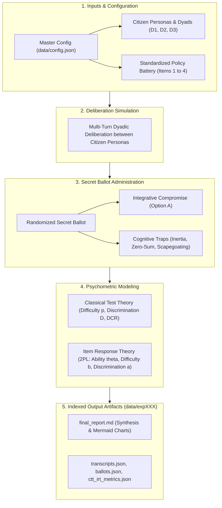

# Deliberative IRT Simulation: Psychometric Benchmarking of Deliberative Capacity & Policy Dilemmas

[](https://www.python.org/downloads/)
[](LICENSE)
[](tests/)

An end-to-end psychometric evaluation framework for **LLM-driven Deliberative Democracy**. This repository applies **Classical Test Theory (CTT)** and **Item Response Theory (IRT)** to standardized multi-agent simulations across contentious public policy dilemmas in Singapore to empirically diagnose:

1. **Item Difficulty ($b_i$)**: Which policy dilemmas are intrinsically harder or more prone to bad-faith traps?
2. **Latent Deliberative Ability ($\theta_j$)**: Which citizen demographic groups struggle most with constructive deliberation?
3. **Item Discrimination ($a_i$)**: Which policy items reliably differentiate high-competence dyads from vulnerable ones?
4. **Distractor Efficiency (DCR)**: Which bad-faith cognitive heuristics (populist inertia, zero-sum technocracy, or foreign scapegoating) derail specific groups?

---

## 1. System Architecture

The simulation benchmark operates as an end-to-end sequential psychometric pipeline:



---

## 2. Standardized Test Battery & Distractor Taxonomy

The test battery consists of 4 standardized, contentious policy dilemmas grounded in Singapore public governance:

| Item ID   | Topic                                | Value Tension                                                          | Key Compromise (Option A) Focus                                                                                    |
| :-------- | :----------------------------------- | :--------------------------------------------------------------------- | :----------------------------------------------------------------------------------------------------------------- |
| `ITEM_01` | **School Mergers & Closures**        | Heritage identity vs. demographic decline & resource pooling.          | Phased merger pooling specialized teachers/labs while preserving alumni archives and subsidized transit.           |
| `ITEM_02` | **Heritage Shophouses vs. MRT Line** | Historical conservation vs. mass transit accessibility.                | Deep-tunnel micro-bored engineering with underpinning at modest cost premium + adaptive re-use entrances.          |
| `ITEM_03` | **Foreign PMET Thresholds**          | Global hub competitiveness vs. local job displacement anxieties.       | Dynamic salary threshold benchmarking paired with MNC-funded retraining levy and structured knowledge transfer.    |
| `ITEM_04` | **Carbon Tax Acceleration**          | Statutory net-zero 2050 pledges vs. regressive cost-of-living impacts. | Aggressive tax trajectory with 100% revenue recycling into progressive household rebates and HDB energy retrofits. |

### Structured Distractor Taxonomy

Each item features 3 tempting deliberative traps representing classic cognitive failure modes:

- **Option B (Distractor 1 - Status Quo Inertia)**: Rigid refusal to adapt; demands deficit spending or freezes without addressing structural realities.
- **Option C (Distractor 2 - Technocratic Zero-Sum)**: Ruthless efficiency maximization completely ignoring citizen lived disruption and community identity.
- **Option D (Distractor 3 - External Scapegoating / Deflection)**: Diverting domestic accountability onto foreign or bureaucratic scapegoats.

---

## 3. Examinee Personas & Dyads

Four archetypal citizen personas cross **Policy Knowledge** and **Affective Polarization**:

- **$P_1$ — Technocratic Pragmatist** (High Knowledge, Low Polarization): Calm, analytical, focused on feasibility, data, and institutional mechanisms.
- **$P_2$ — Ideological Advocate** (High Knowledge, High Polarization): Articulate, morally committed to preservation and equity; skeptical of technocratic coldness.
- **$P_3$ — Disaffected Populist** (Low Knowledge, High Polarization): Emotive, candid, feels sidelined by elites; defensive and prone to scapegoating heuristics.
- **$P_4$ — Open-Minded Everyman** (Low Knowledge, Low Polarization): Plainspoken, humble, constructive; seeks common-sense harmony.

### Dyad Configurations

- **D1 (Ideological Friction)**: $P_1$ vs. $P_2$ (Technocrat vs. Ideologue)
- **D2 (Asymmetric Vulnerability)**: $P_1$ vs. $P_3$ (Technocrat vs. Populist)
- **D3 (Polarized Stalemate)**: $P_2$ vs. $P_3$ (Ideologue vs. Populist)

---

## 4. Psychometric Metrics, Ranges & Mathematical Formulations

This framework combines **Classical Test Theory (CTT)** for direct empirical statistics with **Item Response Theory (IRT)** for model-based latent trait estimation.

### Metric Interpretability & Range Reference Guide

| Metric                              |     Symbol      |  Theoretical Range   | Practical Solver Range | Interpretation & Standard Thresholds                                                                                                                                                                                                                                                                                                                                                    |
| :---------------------------------- | :-------------: | :------------------: | :--------------------: | :-------------------------------------------------------------------------------------------------------------------------------------------------------------------------------------------------------------------------------------------------------------------------------------------------------------------------------------------------------------------------------------- |
| **CTT Difficulty (Pass Rate)**      |      $p_i$      |     $[0.0, 1.0]$     |      $[0.0, 1.0]$      | **Proportion of examinees reaching consensus / selecting Option A.**<br>• $p > 0.80$: Very easy / low resistance dilemma.<br>• $0.20 \le p \le 0.80$: Optimal diagnostic range (maximal item variance).<br>• $p < 0.20$: Very difficult / high-friction polarization trap.<br>_(Note: In psychometrics, higher $p$ = easier item)._                                                     |
| **CTT Item Discrimination**         | $D$ (27% split) |    $[-1.0, +1.0]$    |     $[-1.0, +1.0]$     | **Kelley's Upper-Lower Discrimination Index** ($P_{\text{top}} - P_{\text{bottom}}$).<br>• $D \ge 0.40$: Excellent discrimination.<br>• $0.30 \le D \le 0.39$: Good discrimination.<br>• $0.20 \le D \le 0.29$: Acceptable discrimination.<br>• $0.0 \le D < 0.20$: Poor discrimination.<br>• $D < 0.0$: Defective item (vulnerable groups pass more often than skilled groups).        |
| **Distractor-to-Correct Ratio**     | $\text{DCR}_k$  |   $[0.0, +\infty)$   |    $[0.0, +\infty)$    | **Relative attractiveness of cognitive heuristic $k$ vs. Option A.**<br>• $\text{DCR} = 0.0$: Completely unselected / ineffective distractor.<br>• $0.0 < \text{DCR} < 1.0$: Subdominant trap (Option A chosen more often).<br>• $\text{DCR} = 1.0$: Parity trap (equal frequency to compromise).<br>• $\text{DCR} > 1.0$: Dominant trap (bad-faith heuristic out-competes compromise). |
| **IRT Latent Deliberative Ability** |    $\theta$     | $(-\infty, +\infty)$ |     $[-4.0, +4.0]$     | **Standardized capability of an examinee (dyad or individual persona).**<br>• $\theta > +1.0$: High deliberative ability (readily adopts integrative compromises).<br>• $-0.5 \le \theta \le +0.5$: Average deliberative capacity.<br>• $\theta < -1.0$: Low deliberative ability (highly vulnerable to polarization/traps).                                                            |
| **IRT Item Difficulty**             |      $b_i$      | $(-\infty, +\infty)$ |     $[-4.0, +4.0]$     | **Latent ability $\theta$ required for a 50% probability of compromise.**<br>• $b < -1.0$: Low intrinsic difficulty (readily resolved).<br>• $-1.0 \le b \le +1.0$: Moderate difficulty.<br>• $b > +1.0$: High intrinsic difficulty (requires advanced deliberative skill).                                                                                                             |
| **IRT Item Discrimination**         |      $a_i$      |    $(0, +\infty)$    |      $[0.1, 4.0]$      | **Steepness of Item Characteristic Curve (ICC) at $\theta = b_i$.**<br>• $a < 0.65$: Low discrimination (weak diagnostic power).<br>• $0.65 \le a \le 1.34$: Moderate discrimination.<br>• $1.35 \le a \le 1.69$: High discrimination.<br>• $a \ge 1.70$: Very high discrimination (cleanly separates ability tiers).                                                                   |

---

### A. Classical Test Theory (CTT) Formulations

1. **Item Difficulty ($p_i$)**:
   $$p_i = \frac{N_{\text{passed}}}{N_{\text{total}}}$$
   For dyadic deliberation, an item is passed ($1$) if and only if both agents independently converge on Option A; for individual analysis, it is the rate of selecting Option A.

2. **Item Discrimination Index ($D$)**:
   $$D_i = P_{i,\text{top}} - P_{i,\text{bottom}}$$
   Using Truman Kelley's optimal upper/lower 27% validation split, $D_i$ measures the difference in success rate between the highest-performing test-takers ($P_{\text{top}}$) and the lowest-performing test-takers ($P_{\text{bottom}}$).

3. **Distractor-to-Correct Ratio (DCR)**:
   $$\text{DCR}_k = \frac{\text{Count of selections for Distractor } k}{\text{Count of selections for Option A}}$$
   Diagnoses whether a failure to compromise was driven by **Status Quo Inertia** (Option B), **Technocratic Coldness** (Option C), or **External Scapegoating** (Option D).

---

### B. Item Response Theory (IRT) Formulations

Using a **2-Parameter Logistic (2PL) Model** fitted via regularized Maximum Likelihood Estimation (L-BFGS-B with Gaussian priors on $\theta$, $b$, and $a$):

$$P(Y_{ji} = 1 \mid \theta_j, a_i, b_i) = \frac{1}{1 + e^{-a_i (\theta_j - b_i)}}$$

- $Y_{ji} \in \{0, 1\}$: Binary outcome of examinee $j$ on dilemma $i$.
- $\theta_j$: Latent deliberative competence parameter.
- $b_i$: Dilemma difficulty threshold where $P(Y=1) = 0.50$.
- $a_i$: Dilemma discrimination (slope).

#### Dyadic vs. Individual Ability ($\theta$)

- **Collective Dyadic $\theta$**: Measures joint communicative convergence (both agents must vote for Option A). Captures emergent dyadic friction or harmony.
- **Individual Persona $\theta$**: Measures each citizen persona's independent baseline propensity to choose integrative compromises across dilemmas, as well as **partner conditioning effects** (how an individual's $\theta$ changes when paired with different demographic counterparts).

---

### C. Foundational Psychometric References

Direct 1:1 correspondence between each implemented metric and its underlying foundational literature:

- **IRT Parameters ($\theta_j, b_i, a_i$)**:  
  **[The Basics of Item Response Theory](https://eric.ed.gov/?id=ED458219)** — _Frank B. Baker (ERIC Clearinghouse on Assessment and Evaluation, 2001)_.  
  Underlying source for the 2-Parameter Logistic (2PL) model, Item Characteristic Curves (ICCs), and the standard discrimination ($a_i$) classification scale.

- **CTT Item Discrimination ($D$)**:  
  **[The Selection of Upper and Lower Groups for the Validation of Test Items](https://doi.org/10.1037/h0057123)** — _Truman L. Kelley (Journal of Educational Psychology, 1939)_ & **[Essentials of Educational Measurement](https://archive.org/details/essentialsofeduc0000ebel)** — _Robert L. Ebel & David A. Frisbie (Prentice-Hall, 1991)_.  
  Underlying mathematical proof for the optimal 27% upper-and-lower split and the standard empirical diagnostic thresholds for $D$.

- **Distractor-to-Correct Ratio ($\text{DCR}_k$)**:  
  **[Developing and Validating Multiple-Choice Test Items](https://www.routledge.com/Developing-and-Validating-Multiple-Choice-Test-Items/Haladyna-Rodriguez/p/book/9780415996075)** — _Thomas M. Haladyna (Routledge, 2004)_.  
  Underlying methodology for evaluating distractor plausibility, distractor functioning, and calculating selection ratios relative to Option A.

---

## 5. Repository Structure

```text
simple-simulation-irt-evaluation-in-deliberation/
├── data/
│   ├── config.json                     # Master simulation configuration
│   ├── items/                          # Standardized test battery
│   │   ├── item01_school_mergers.json
│   │   ├── item02_heritage_mrt.json
│   │   ├── item03_foreign_talent.json
│   │   └── item04_carbon_tax.json
│   └── exp003/                         # Auto-incrementing experiment run output
│       ├── config.json                 # Run configuration snapshot
│       ├── items/                      # Snapshot of battery items evaluated in run
│       ├── transcripts.json            # Complete deliberation transcripts
│       ├── ballots.json                # Post-deliberation secret votes
│       ├── ctt_irt_metrics.json        # Estimated θ, b, a, and DCR values
│       └── final_report.md             # Markdown synthesis of findings
├── docs/
│   ├── experiment_design_irt_deliberation.md
│   └── prompt_templates.md
├── src/
│   ├── __init__.py
│   ├── main.py                         # Master orchestrator (execute_simulation_run) & CLI entry point
│   ├── deliberation.py                 # Multi-turn dyadic deliberation chat loop
│   ├── ballot.py                       # Secret ballot runner with option display randomization
│   ├── psychometrics.py                # CTT & IRT (1PL/2PL) regularized optimization engine
│   ├── personas.py                     # Persona metadata & configuration prompt resolution
│   ├── llm.py                          # OpenAI client with .env credentials and fallback models
│   ├── schemas.py                      # Built-in typing schemas (TypedDict)
│   └── report.py                       # Synthesis and Markdown report compiler
├── tests/
│   ├── __init__.py
│   ├── test_ballot_parser.py           # Validates option extraction and randomization
│   ├── test_psychometrics.py           # Validates CTT & IRT monotonicity & bounds
│   ├── test_deliberation.py            # Validates dialogue turn structure
│   └── test_pipeline.py                # End-to-end integration test
├── .env.example
├── pyproject.toml
├── requirements.txt
└── README.md
```

---

## 6. Quickstart & Installation

### Installation

Clone the repository and install dependencies:

```bash
git clone https://github.com/your-username/deliberative-irt-simulation.git
cd deliberative-irt-simulation
pip install -r requirements.txt
```

### Environment Configuration (.env)

Configure your OpenAI-compatible endpoint credentials (e.g., Together AI, vLLM, OpenRouter) in `.env`. Both `OPENAI_API_KEY` and `OPENAI_BASE_URL` are required; there are no dummy fallback credentials, and runs will fail immediately if they are missing.

```env
OPENAI_API_KEY=your-api-key-here
OPENAI_BASE_URL=https://api.together.xyz/v1

# Default models (used directly or as fallback if config.json model is unavailable)
AGENT_MODEL=openai/gpt-oss-120b
MODEL_GPT_OSS=openai/gpt-oss-120b
```

### Running Unit & Integration Tests

```bash
python3 -m pytest tests -v
```

### Running a Simulation Experiment

All experimental parameters (models, turns, trials, dyads, items, and `mcq_option_order_seed`) are configured centrally in `data/config.json`. The CLI accepts **only** the path to the configuration file.

Run with default configuration (`data/config.json`):

```bash
python3 -m src.main
```

Or specify a custom configuration file:

```bash
python3 -m src.main --config path/to/custom_config.json
```

Artifacts are dynamically written to the next auto-incremented `data/expXXX/` directory:

- `data/expXXX/final_report.md`: Complete Markdown synthesis with Mermaid diagrams and psychometric tables
- `data/expXXX/ctt_irt_metrics.json`: Fitted $\theta$, $b$, $a$, DCRs, and governance rankings
- `data/expXXX/transcripts.json`: Full dialogue transcripts of deliberations
- `data/expXXX/ballots.json`: Independent secret ballot selections
- `data/expXXX/config.json`: Snapshot of the configuration used for the experiment run
- `data/expXXX/items/`: Snapshot of all policy battery item definitions used for the run

#### Modifying Experiment Parameters

To customize parameters such as the number of trials or models, update your configuration file (e.g. `data/config.json`):

```json
{
  "model_config": {
    "agent_model": "openai/gpt-oss-120b"
  },
  "deliberation_config": {
    "turns_per_item": 4,
    "trials_per_item": 5,
    "mcq_option_order_seed": 42
  }
}
```

---

## 7. Built-in Code Defaults & Fallback Reference

All default parameters, fallback chains, and optimization bounds hardcoded within Python logic are documented below:

| Module / Scope                                  | Parameter                    | Code Default / Fallback                          | Behavior & Purpose                                                                                                                                                                                                |
| :---------------------------------------------- | :--------------------------- | :----------------------------------------------- | :---------------------------------------------------------------------------------------------------------------------------------------------------------------------------------------------------------------- |
| **Model Resolution** (`src/llm.py`)             | `agent_model`                | `"openai/gpt-oss-120b"`                          | Read from `config.json`. If missing or unavailable on endpoint, falls back through `.env`: `AGENT_MODEL` $\rightarrow$ `DEFAULT_AGENT_MODEL` $\rightarrow$ `MODEL_GPT_OSS` $\rightarrow$ `"openai/gpt-oss-120b"`. |
| **API Credentials** (`src/llm.py`)              | `api_key`, `base_url`        | **No fallback**                                  | Strictly read from `OPENAI_API_KEY` and `OPENAI_BASE_URL` in `.env`. Fails fast with `ValueError` if either is missing.                                                                                           |
| **Dialogue Turns** (`src/deliberation.py`)      | `temperature` / `max_tokens` | `0.7` / `512`                                    | Balanced exploratory sampling for multi-turn citizen dialogue.                                                                                                                                                    |
| **Secret Ballot** (`src/ballot.py`)             | `temperature` / `max_tokens` | `0.3` / `32`                                     | Low temperature ensures deterministic single-letter option voting.                                                                                                                                                |
| **Ballot Fallback** (`src/ballot.py`)           | Parsed Letter                | `"A"`                                            | If an LLM response cannot be parsed via regex into A/B/C/D, defensively defaults to `"A"` to prevent crash.                                                                                                       |
| **Simulation Matrix** (`src/main.py`)           | `turns_per_item`             | `4`                                              | 4 alternating dialogue turns per session (2 turns per persona).                                                                                                                                                   |
| **Simulation Matrix** (`src/main.py`)           | `trials_per_item`            | `5`                                              | 5 independent trials per item-dyad combination (60 total sessions across benchmark).                                                                                                                              |
| **Option Shuffling Seed** (`src/main.py`)       | `mcq_option_order_seed`      | `42` (legacy fallback: `seed`)                   | Base pseudo-random seed for shuffling multiple-choice ballot option presentation order (A/B/C/D) to mitigate LLM position bias.                                                                                   |
| **Output Directory** (`src/main.py`)            | `output_dir`                 | `data/expXXX/`                                   | Auto-detects highest existing `expXXX` and increments to the next index (starts at `exp000`).                                                                                                                     |
| **IRT Regularization** (`src/psychometrics.py`) | L2 Priors ($\lambda$)        | `0.5` ($\theta, b$), `0.5` ($a - 1$)             | Regularizes maximum likelihood estimation against overfitting on small samples.                                                                                                                                   |
| **IRT Optimization** (`src/psychometrics.py`)   | Parameter Bounds             | $\theta, b \in [-4.0, +4.0]$, $a \in [0.1, 4.0]$ | Bounded L-BFGS-B optimization (`maxiter=500, ftol=1e-6`).                                                                                                                                                         |
| **CTT Group Split** (`src/psychometrics.py`)    | Upper/Lower Ratio            | 27%                                              | Truman Kelley's optimal top/bottom 27% split (`math.ceil(0.27 * N)`).                                                                                                                                             |

---

## 8. License

This repository is distributed under the MIT License. See [LICENSE](LICENSE) for details.
