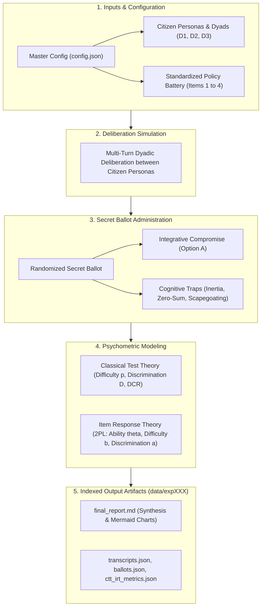

# Deliberative Item Response Theory (IRT) Benchmark Report

**Generated:** 2026-10-27 13:54:50  
**Benchmark:** IRT Deliberative Capacity Benchmark  
**Model:** `openai/gpt-oss-120b`  
**Execution Matrix:** 5 trials/dyad across 4 dyads and 4 items (80 total sessions, 160 secret ballots)  
**Per-Item Sample:** 20 deliberative sessions (40 individual secret ballots cast)  

---

## 1. Executive Summary & Core Insights

This psychometric benchmark evaluates **latent deliberative capacity ($\theta$)** across diverse citizen demographic dyads and measures **item difficulty ($b$)**, **item discrimination ($a$)**, and **distractor efficiency (DCR)** across standardized Singapore public policy dilemmas.

### Key Empirical Findings:
- **Most Challenging Policy Dilemma**: Policy item `ITEM_01` exhibited the highest intrinsic difficulty parameter ($b$).
- **Most Accessible Compromise**: Policy item `ITEM_04` had the lowest difficulty parameter, proving most receptive to common ground.
- **Most Diagnostic Dilemma**: Policy item `ITEM_04` showed the highest discrimination parameter ($a$), reliably distinguishing high-deliberation dyads from vulnerable ones.
- **Most Vulnerable Citizen Dyad**: Dyad `D1` demonstrated the lowest baseline latent deliberative competence ($\theta$).
- **Most Tempting Distractor Trap**: Option `D` was the most frequently chosen bad-faith heuristic across participants.

---

## 2. Deliberation & Psychometric Architecture

---

## 3. Standardized Policy Battery Psychometrics (CTT & IRT)

| Item ID | Policy Topic | Consensus Rate ($p_i$) | IRT Difficulty ($b_i$) | Discrimination ($a_i$) | DCR (B: Inertia) | DCR (C: Zero-Sum) | DCR (D: Scapegoat) |
| :--- | :--- | :---: | :---: | :---: | :---: | :---: | :---: |
| `ITEM_01` | School Closures and Mergers in Sin... | 0.05 | 1.319 | 2.2792 | 1.2727 | 0.4545 | 0.9091 |
| `ITEM_02` | Heritage Shophouses vs. MRT Line C... | 0.1 | 1.2381 | 1.5736 | 0.7273 | 0.7273 | 1.1818 |
| `ITEM_03` | Foreign PMET Salary Thresholds and... | 0.05 | 1.319 | 2.2792 | 0.75 | 0.8333 | 0.75 |
| `ITEM_04` | Transboundary Haze Enforcement and... | 0.15 | 0.6256 | 2.9152 | 0.9091 | 0.7273 | 1.0 |

> [!NOTE]
> **Sample Size & Metric Interpretation Guide**:
> - **Consensus Rate ($p_i$)**: The proportion of deliberative sessions where *both* participants in the dyad simultaneously voted for Option A. Evaluated over all **20 sessions** for that dilemma ($5\text{ trials} \times 4\text{ dyads}$).  
> - **DCR (Distractor-to-Correct Ratio)**: A relative ratio against Option A, **not a percentage of total votes**: $\text{DCR}_k = \frac{\text{Count}(\text{Distractor } k)}{\text{Count}(\text{Option A})}$. Evaluated across all **40 individual secret ballots** cast for that dilemma.  
>   - $\text{DCR} > 1.0$: Dominant trap (bad-faith heuristic was chosen *more frequently* than the compromise).  
>   - $\text{DCR} < 1.0$: Subdominant trap (Option A was chosen more frequently than this heuristic).  
>   - $\text{DCR} = 1.0$: Parity trap (equal frequency to compromise).  
>   - *Note on vote percentages*: DCR values do not sum to 100%. The actual percentage of votes for Option A is $\frac{1}{1 + \text{DCR}_B + \text{DCR}_C + \text{DCR}_D} \times 100\%$.  
> - **IRT Difficulty ($b_i$) & Discrimination ($a_i$)**: Fitted simultaneously across the entire 80-session matrix using regularized 2PL Maximum Likelihood. Higher $b_i$ indicates greater intrinsic resistance to consensus; higher $a_i$ indicates sharper diagnostic separation between high- and low-competence dyads.

---

## 4. Latent Deliberative Ability Breakdown ($\theta$)

### 4.1 Dyadic Deliberative Competence (Consensus Requirement)
Estimated collective latent competence $\theta$ across citizen dyad configurations (an item is passed only when both participants reach consensus on Option A):

| Dyad ID | Citizen Composition | Deliberative Dynamic | Collective Competence ($\theta$) | Relative Ranking |
| :--- | :--- | :--- | :---: | :---: |
| `D4` | Ideologue vs Everyman | Rhetorical Dominance | -0.0422 | #1 |
| `D3` | Ideologue vs Populist | Polarized Stalemate | -0.201 | #2 |
| `D2` | Technocrat vs Populist | Asymmetric Vulnerability | -0.2944 | #3 |
| `D1` | Technocrat vs Ideologue | Ideological Friction | -0.362 | #4 |

### 4.2 Individual Persona Deliberative Competence
Estimated latent ability $\theta$ for each citizen persona based on independent secret ballots, measuring personal propensity to endorse integrative solutions irrespective of partner agreement:

| Persona ID | Role Title | Option A Endorsement Rate | Latent Competence ($\theta$) | Relative Ranking |
| :--- | :--- | :---: | :---: | :---: |
| `populist` | Disaffected Populist (P3) | 40.0% | 0.2496 | #1 |
| `everyman` | Open-Minded Everyman (P4) | 35.0% | 0.1496 | #2 |
| `technocrat` | Technocratic Pragmatist (P1) | 27.5% | -0.1232 | #3 |
| `ideologue` | Ideological Advocate (P2) | 18.3% | -0.303 | #4 |

### 4.3 Partner Interaction Effects (Dyadic Conditioning)
How each individual persona's latent competence shifts depending on conversational partner in the dyad:

| Persona | Partner Dynamic in Dyad | Latent Competence ($\theta$) | Observed Shift / Context |
| :--- | :--- | :---: | :--- |
| Open-Minded Everyman (P4) | `D4` (Rhetorical Dominance) | 0.1496 | Paired in Ideologue vs Everyman |
| Ideological Advocate (P2) | `D1` (Ideological Friction) | -0.3026 | Paired in Technocrat vs Ideologue |
| Ideological Advocate (P2) | `D3` (Polarized Stalemate) | -0.5343 | Paired in Ideologue vs Populist |
| Ideological Advocate (P2) | `D4` (Rhetorical Dominance) | -0.0722 | Paired in Ideologue vs Everyman |
| Disaffected Populist (P3) | `D2` (Asymmetric Vulnerability) | 0.489 | Paired in Technocrat vs Populist |
| Disaffected Populist (P3) | `D3` (Polarized Stalemate) | 0.0102 | Paired in Ideologue vs Populist |
| Technocratic Pragmatist (P1) | `D1` (Ideological Friction) | -0.0763 | Paired in Technocrat vs Ideologue |
| Technocratic Pragmatist (P1) | `D2` (Asymmetric Vulnerability) | -0.17 | Paired in Technocrat vs Populist |

---

## 5. Cognitive Trap & Distractor Vulnerability Analysis

The standardized assessment tests three distinct heuristic failure modes:
1. **Option B (Status Quo Inertia Trap)**: Rigid refusal to adapt; demanding infinite subsidies without addressing structural change.
2. **Option C (Technocratic Zero-Sum Trap)**: Aggressive efficiency-only policy that completely disregards human/community disruption.
3. **Option D (External Scapegoating / Deflection Trap)**: Deflecting structural challenges onto foreign or elite scapegoats without a viable solution.

### Average Distractor Efficiency Across All Dilemmas:
- **Option B (Status Quo Inertia)**: Average DCR = `0.9148`
- **Option C (Technocratic Zero-Sum)**: Average DCR = `0.6856`
- **Option D (External Scapegoating)**: Average DCR = `0.9602`

---

## 6. Policy Governance Implications

1. **Prioritize Facilitation on Item `ITEM_01`**: This dilemma exhibited the greatest resistance to compromise ($b = 1.319$). Policymakers and deliberative moderators should provide extra contextual briefings and transition guarantees on this topic.
2. **Mitigate Vulnerability in Dyad `D1`**: This citizen grouping struggled most with constructive dialogue ($\theta = -0.362$). Structured perspective-taking exercises and active mediation should be targeted at this demographic pairing.
3. **Inoculate Against `D` Traps**: The highest distractor selection was observed for Option D, indicating that public discourse is most susceptible to this specific bad-faith heuristic.

---
*Report automatically generated by `deliberative-irt-simulation` psychometrics pipeline.*