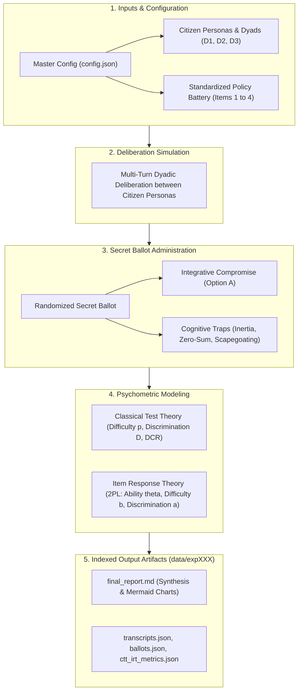

# Deliberative Item Response Theory (IRT) Benchmark Report

**Generated:** 2026-10-26 19:10:34  
**Benchmark:** IRT Deliberative Capacity Benchmark  
**Model:** `openai/gpt-oss-120b`  
**Trials per Item:** 5  

---

## 1. Executive Summary & Core Insights

This psychometric benchmark evaluates **latent deliberative capacity ($\theta$)** across diverse citizen demographic dyads and measures **item difficulty ($b$)**, **item discrimination ($a$)**, and **distractor efficiency (DCR)** across standardized Singapore public policy dilemmas.

### Key Empirical Findings:
- **Most Challenging Policy Dilemma**: Policy item `ITEM_04` exhibited the highest intrinsic difficulty parameter ($b$).
- **Most Accessible Compromise**: Policy item `ITEM_01` had the lowest difficulty parameter, proving most receptive to common ground.
- **Most Diagnostic Dilemma**: Policy item `ITEM_01` showed the highest discrimination parameter ($a$), reliably distinguishing high-deliberation dyads from vulnerable ones.
- **Most Vulnerable Citizen Dyad**: Dyad `D2` demonstrated the lowest baseline latent deliberative competence ($\theta$).
- **Most Tempting Distractor Trap**: Option `B` was the most frequently chosen bad-faith heuristic across participants.

---

## 2. Deliberation & Psychometric Architecture

---

## 3. Standardized Policy Battery Psychometrics (CTT & IRT)

| Item ID | Policy Topic | Consensus Rate ($p_i$) | IRT Difficulty ($b_i$) | Discrimination ($a_i$) | DCR (B: Inertia) | DCR (C: Zero-Sum) | DCR (D: Scapegoat) |
| :--- | :--- | :---: | :---: | :---: | :---: | :---: | :---: |
| `ITEM_01` | School Closures and Mergers in Sin... | 0.0667 | 1.0028 | 2.1455 | 1.0 | 1.0 | 1.2857 |
| `ITEM_02` | Heritage Shophouses vs. MRT Line C... | 0.0667 | 1.0028 | 2.1455 | 1.2857 | 1.1429 | 0.8571 |
| `ITEM_03` | Foreign PMET Salary Thresholds and... | 0.0667 | 1.0028 | 2.1455 | 1.0 | 0.875 | 0.875 |
| `ITEM_04` | Carbon Tax Trajectory and Cost-of-... | 0.0 | 1.6353 | 2.1157 | 1.6667 | 1.1667 | 1.1667 |

> [!NOTE]
> **IRT Difficulty ($b_i$)**: Higher values indicate dilemmas that are intrinsically harder to resolve constructively.  
> **IRT Discrimination ($a_i$)**: Measures how effectively an item distinguishes high-competence from low-competence dyads.  
> **DCR (Distractor-to-Correct Ratio)**: Ratio of selections for that trap relative to the integrative compromise (Option A).

---

## 4. Latent Deliberative Ability Breakdown ($\theta$)

### 4.1 Dyadic Deliberative Competence (Consensus Requirement)
Estimated collective latent competence $\theta$ across citizen dyad configurations (an item is passed only when both participants reach consensus on Option A):

| Dyad ID | Citizen Composition | Deliberative Dynamic | Collective Competence ($\theta$) | Relative Ranking |
| :--- | :--- | :--- | :---: | :---: |
| `D3` | Ideologue vs Populist | Polarized Stalemate | -0.101 | #1 |
| `D1` | Technocrat vs Ideologue | Ideological Friction | -0.3096 | #2 |
| `D2` | Technocrat vs Populist | Asymmetric Vulnerability | -0.5181 | #3 |

### 4.2 Individual Persona Deliberative Competence
Estimated latent ability $\theta$ for each citizen persona based on independent secret ballots, measuring personal propensity to endorse integrative solutions irrespective of partner agreement:

| Persona ID | Role Title | Option A Endorsement Rate | Latent Competence ($\theta$) | Relative Ranking |
| :--- | :--- | :---: | :---: | :---: |
| `populist` | Disaffected Populist (P3) | 25.0% | -0.0883 | #1 |
| `technocrat` | Technocratic Pragmatist (P1) | 22.5% | -0.1014 | #2 |
| `ideologue` | Ideological Advocate (P2) | 22.5% | -0.1371 | #3 |

### 4.3 Partner Interaction Effects (Dyadic Conditioning)
How each individual persona's latent competence shifts depending on conversational partner in the dyad:

| Persona | Partner Dynamic in Dyad | Latent Competence ($\theta$) | Observed Shift / Context |
| :--- | :--- | :---: | :--- |
| Ideological Advocate (P2) | `D1` (Ideological Friction) | -0.2669 | Paired in Technocrat vs Ideologue |
| Ideological Advocate (P2) | `D3` (Polarized Stalemate) | -0.0074 | Paired in Ideologue vs Populist |
| Disaffected Populist (P3) | `D2` (Asymmetric Vulnerability) | -0.164 | Paired in Technocrat vs Populist |
| Disaffected Populist (P3) | `D3` (Polarized Stalemate) | -0.0126 | Paired in Ideologue vs Populist |
| Technocratic Pragmatist (P1) | `D1` (Ideological Friction) | -0.0996 | Paired in Technocrat vs Ideologue |
| Technocratic Pragmatist (P1) | `D2` (Asymmetric Vulnerability) | -0.1033 | Paired in Technocrat vs Populist |

---

## 5. Cognitive Trap & Distractor Vulnerability Analysis

The standardized assessment tests three distinct heuristic failure modes:
1. **Option B (Status Quo Inertia Trap)**: Rigid refusal to adapt; demanding infinite subsidies without addressing structural change.
2. **Option C (Technocratic Zero-Sum Trap)**: Aggressive efficiency-only policy that completely disregards human/community disruption.
3. **Option D (External Scapegoating / Deflection Trap)**: Deflecting structural challenges onto foreign or elite scapegoats without a viable solution.

### Average Distractor Efficiency Across All Dilemmas:
- **Option B (Status Quo Inertia)**: Average DCR = `1.2381`
- **Option C (Technocratic Zero-Sum)**: Average DCR = `1.0461`
- **Option D (External Scapegoating)**: Average DCR = `1.0461`

---

## 6. Policy Governance Implications

1. **Prioritize Facilitation on Item `ITEM_04`**: This dilemma exhibited the greatest resistance to compromise ($b = 1.6353$). Policymakers and deliberative moderators should provide extra contextual briefings and transition guarantees on this topic.
2. **Mitigate Vulnerability in Dyad `D2`**: This citizen grouping struggled most with constructive dialogue ($\theta = -0.5181$). Structured perspective-taking exercises and active mediation should be targeted at this demographic pairing.
3. **Inoculate Against `B` Traps**: The highest distractor selection was observed for Option B, indicating that public discourse is most susceptible to this specific bad-faith heuristic.

---
*Report automatically generated by `deliberative-irt-simulation` psychometrics pipeline.*