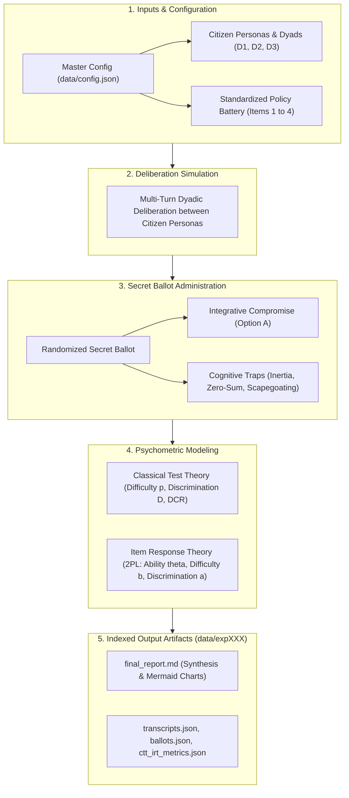

# Deliberative IRT Simulation: Psychometric Benchmarking of Deliberative Capacity & Policy Dilemmas

## 1. Context & Benchmark Motivation

In LLM-driven multi-agent deliberative democracy, evaluating conversational settings has historically relied on post-hoc, continuous text metrics like embedding cosine similarity, stance shift, or LLM-as-a-Judge Discourse Quality Index (DQI). While qualitative, these metrics often suffer from model sycophancy, lack statistical standard error bounds, and fail to provide actionable diagnostic answers to two fundamental governance questions:
1. **Which citizen demographic groups struggle most with constructive, compromise-oriented deliberation?**
2. **Which public policy dilemmas are intrinsically harder or more prone to bad-faith cognitive traps?**

This benchmark bridges psychometric theory—specifically **Classical Test Theory (CTT)** and **Item Response Theory (IRT)**—into multi-agent deliberative simulation. By formalizing policy dilemmas as **standardized test items** with structured **integrative compromises ("Option A Key")** and tempting **bad-faith cognitive heuristics ("Distractors B, C, D")**, the benchmark quantitatively estimates:
- **Latent Deliberative Ability ($\theta_j$)**: A continuous scale of deliberative competence for each citizen persona pairing.
- **Item Difficulty ($b_i$)**: How resistant each policy dilemma is to consensus and integrative compromise.
- **Item Discrimination ($a_i$)**: How sharply each policy dilemma distinguishes high-competence dyads from vulnerable ones.
- **Distractor Efficiency (DCR)**: The ratio of trap selections to correct compromise selections, identifying which specific cognitive failure modes derail public discourse.

---

## 2. Benchmark Design & Simplified Observational Paradigm

The benchmark evaluates multi-agent policy deliberation across diverse citizen pairings and Singapore governance dilemmas without artificial control/treatment splits or prompt trickery. It is an **observational psychometric test battery**:
- Diverse archetypal citizen dyads deliberate on standardized policy dilemmas.
- Following multi-turn deliberation, each persona independently and privately casts a secret ballot.
- Consensus is reached if and only if both personas in the dyad independently select the integrative compromise (**Option A**).
- Observed ballot distributions are aggregated across trials and fitted to CTT and 2PL IRT models to characterize both item properties and dyad deliberative competence.

---

## 3. The Standardized Policy Test Battery

The battery comprises **4 standardized policy dilemmas** grounded in Singapore public governance. Each item features a substantive value tension, an integrative compromise, and three tempting cognitive distractors:

| Item ID | Topic | Competing Value Tension | Key Compromise (Option A) Focus |
| :--- | :--- | :--- | :--- |
| `ITEM_01` | **School Mergers & Closures** | Heritage identity vs. demographic decline & resource pooling. | Phased merger pooling specialized teachers/labs while preserving alumni archives and subsidized transit. |
| `ITEM_02` | **Heritage Shophouses vs. MRT Line** | Historical conservation vs. mass transit accessibility. | Deep-tunnel micro-bored engineering with underpinning at modest cost premium + adaptive re-use entrances. |
| `ITEM_03` | **Foreign PMET Thresholds** | Global hub competitiveness vs. local job displacement anxieties. | Dynamic salary threshold benchmarking paired with MNC-funded retraining levy and structured knowledge transfer. |
| `ITEM_04` | **Carbon Tax Acceleration** | Statutory net-zero 2050 pledges vs. regressive cost-of-living impacts. | Aggressive tax trajectory with 100% revenue recycling into progressive household rebates and HDB energy retrofits. |

### Structured Distractor Taxonomy
Each policy dilemma includes 3 standardized bad-faith cognitive traps:
- **Option B (Distractor 1 - Status Quo Inertia Trap)**: Rigid refusal to adapt; demands deficit spending or policy freezes regardless of demographic or fiscal reality.
- **Option C (Distractor 2 - Technocratic Zero-Sum Trap)**: Ruthless efficiency maximization that completely disregards lived disruption, community identity, and human equity.
- **Option D (Distractor 3 - External Scapegoating / Deflection Trap)**: Deflecting structural domestic challenges onto foreign or elite scapegoats without a viable solution.

---

## 4. Examinee Personas & Citizen Dyads

Four archetypal citizen personas cross **Policy Knowledge** and **Affective Polarization**:

1. **$P_1$ — Technocratic Pragmatist** (High Knowledge, Low Affective Polarization):
   - Approached dilemmas with analytical rigor, fiscal awareness, and institutional realism. Calm, professional, objective.
2. **$P_2$ — Ideological Advocate** (High Knowledge, High Affective Polarization):
   - Deep policy knowledge but strong, principled moral commitments (social equity, cultural heritage, climate justice). Skeptical of bureaucratic coldness.
3. **$P_3$ — Disaffected Populist** (Low Knowledge, High Affective Polarization):
   - Feels everyday citizens are sidelined by out-of-touch elites and rising costs. Emotive, candid, skeptical, prone to scapegoating heuristics.
4. **$P_4$ — Open-Minded Everyman** (Low Knowledge, Low Affective Polarization):
   - Represents the average citizen without policy jargon. Speaks plainly, listens actively, respects differing viewpoints, seeks harmonious solutions.

### Dyad Configurations
To diagnose interpersonal friction and vulnerability, personas are paired into 3 standardized dyads:
- **D1 (Ideological Friction)**: $P_1$ vs. $P_2$ (Technocrat vs. Ideologue)
- **D2 (Asymmetric Vulnerability)**: $P_1$ vs. $P_3$ (Technocrat vs. Populist)
- **D3 (Polarized Stalemate)**: $P_2$ vs. $P_3$ (Ideologue vs. Populist)

---

## 5. Psychometric Formulations

### A. Classical Test Theory (CTT)
1. **Item Difficulty ($p_i$)**:
   $$p_i = \frac{N_{\text{consensus}}}{N_{\text{total}}}$$
   Where consensus is achieved when both agents independently vote for Option A.
2. **Distractor-to-Correct Ratio (DCR)**:
   $$\text{DCR}_k = \frac{\text{Count of selections for Distractor } k}{\text{Count of selections for Option A}}$$
   A high $\text{DCR}_k$ indicates an exceptionally alluring cognitive trap.
3. **Item Discrimination ($D_{27\%}$)**:
   $$D_i = P_{i,\text{top 27\%}} - P_{i,\text{bottom 27\%}}$$
   Differentiates performance of top-performing dyads from bottom-performing dyads.

### B. Item Response Theory (IRT)
Using a **2-Parameter Logistic (2PL) Model** fitted via regularized Maximum Likelihood Estimation:
$$P(Y_{ij} = 1 \mid \theta_j, a_i, b_i) = \frac{1}{1 + e^{-a_i (\theta_j - b_i)}}$$
- $\theta_j$: Latent deliberative ability of dyad $j$.
- $b_i$: Difficulty parameter of policy dilemma $i$ (higher = more resistant to consensus).
- $a_i$: Discrimination parameter of policy dilemma $i$ (higher = sharper diagnostic precision).

---

## 6. System Architecture & End-to-End Pipeline

The benchmark runs as a streamlined 5-phase sequential pipeline:



### Execution Steps
1. **Load Configuration**: Read `data/config.json` (or CLI-specified path) and battery items from `data/items/`.
2. **Conduct Deliberation**: For each trial, dyad, and item, agents engage in a 4-turn alternating conversation. Conversation history is tracked verbatim.
3. **Administer Secret Ballot**: Each agent independently votes on the policy resolution. Display order of options is randomized to prevent position bias. Choices are defensively parsed via regex.
4. **Fit Psychometrics**: CTT metrics ($p_i, D_i, \text{DCR}$) and 2PL IRT parameters ($\theta_j, b_i, a_i$) are calculated.
5. **Persist Artifacts**: All results are saved into the next auto-incremented `data/expXXX/` directory.

---

## 7. Strict Coding Guidelines for Reproduction

To allow autonomous agents or researchers to reproduce this codebase reliably, the repository strictly enforces seven architectural guidelines:

### Guideline 1: Strict Typing with Built-in Types (No Pydantic)
- All data schemas must use Python built-in `typing.TypedDict` (no heavy validation libraries like Pydantic).
- Schemas are defined in `src/schemas.py`.

### Guideline 2: Separation of Concerns & File Modularity
- `src/main.py`: Orchestrator and entry point (`execute_simulation_run`).
- `src/deliberation.py`: Chat loops, prompt resolution, and turn generation.
- `src/ballot.py`: Secret ballot runner with randomized display order and defensive regex parsing.
- `src/psychometrics.py`: CTT and 2PL IRT numerical optimization engine.
- `src/personas.py`: Persona registry and prompt resolution.
- `src/llm.py`: Production `OpenAIClient` reading `.env` credentials with model fallbacks.
- `src/report.py`: Markdown synthesis report generator.

### Guideline 3: Single-Responsibility Functions
- Every function has a clear, explicit name and docstring (e.g., `execute_simulation_run`, `conduct_deliberation`, `administer_dyad_ballot`, `analyze_experiment_psychometrics`).

### Guideline 4: Total Configuration Abstraction (Zero Hardcoded Prompts)
- Absolutely zero prompt strings or textual templates exist in Python logic.
- All prompts are loaded dynamically from `data/config.json`.
- All `dict.get()` calls default to `""` rather than fallback text.

### Guideline 5: Defensive LLM Parsing
- All ballot option extraction uses defensive regex wrapped in `try/except` to robustly handle markdown bolding, prefixes, and punctuation.

### Guideline 6: Dynamic Output Directory Indexing
- Every execution dynamically discovers existing `data/expXXX/` directories and writes to the next incremented index (e.g., `data/exp000/`, `data/exp001/`). Past runs are never overwritten.

### Guideline 7: Documentation Transparency for Code Defaults (Hygiene)
- Any default configurations, parameter values, or fallback behaviors embedded in Python logic (e.g., fallback model `openai/gpt-oss-120b` in `src/llm.py`, default inference temperature/max_tokens, default seeds, or fallback directory resolutions) MUST be explicitly mentioned in `README.md`.
- No hidden or undocumented assumptions: If code logic assumes or falls back to a specific default value when an environment variable or config field is omitted, that default must be documented prominently in the README setup instructions to maintain clean engineering hygiene and reproducibility.

---

## 8. Configuration Specification (`data/config.json`)

```json
{
  "experiment_metadata": {
    "name": "IRT Deliberative Capacity Benchmark",
    "description": "Observing latent deliberative competence and item psychometrics across diverse citizen groups and Singapore policy dilemmas",
    "version": "2.0.0"
  },
  "model_config": {
    "agent_model": "openai/gpt-oss-120b",
    "temperature": 0.7,
    "max_tokens": 512
  },
  "system_prompts": {
    "technocrat": "...",
    "ideologue": "...",
    "populist": "...",
    "everyman": "..."
  },
  "user_prompts": {
    "deliberation_turn": "...",
    "secret_ballot": "..."
  },
  "items": [
    "data/items/item01_school_mergers.json",
    "data/items/item02_heritage_mrt.json",
    "data/items/item03_foreign_talent.json",
    "data/items/item04_carbon_tax.json"
  ],
  "deliberation_config": {
    "turns_per_item": 4,
    "trials_per_item": 5,
    "seed": 42,
    "dyads": [
      {
        "id": "D1",
        "name": "Technocrat vs Ideologue",
        "dynamic": "Ideological Friction",
        "agents": ["technocrat", "ideologue"]
      },
      {
        "id": "D2",
        "name": "Technocrat vs Populist",
        "dynamic": "Asymmetric Vulnerability",
        "agents": ["technocrat", "populist"]
      },
      {
        "id": "D3",
        "name": "Ideologue vs Populist",
        "dynamic": "Polarized Stalemate",
        "agents": ["ideologue", "populist"]
      }
    ]
  }
}
```

---

## 9. CLI Interface & Execution Commands

The CLI entry point accepts **strictly one optional argument**: `--config`. All other experimental parameters must be specified within the configuration JSON file.

### CLI Usage
```bash
# Run with default configuration (data/config.json)
python3 -m src.main

# Run with custom configuration file
python3 -m src.main --config path/to/custom_config.json

# Check usage help (only --config is displayed)
python3 -m src.main --help
```

### Environment Credentials (`.env`)
```env
OPENAI_API_KEY=your-api-key
OPENAI_BASE_URL=https://api.together.xyz/v1
AGENT_MODEL=openai/gpt-oss-120b
MODEL_GPT_OSS=openai/gpt-oss-120b
```

---

## 10. Persisted Output Artifacts (`data/expXXX/`)

Each experiment run generates its outputs in its dedicated indexed directory:
1. `config.json`: Complete snapshot of the configuration used for the run.
2. `items/`: Full directory snapshot of the policy battery item JSONs evaluated during the run.
3. `transcripts.json`: Complete record of all dialogue turns across dyads and trials.
4. `ballots.json`: Independent secret ballot choices, randomized letter mappings, and consensus records.
5. `ctt_irt_metrics.json`: Fitted psychometric parameters ($\theta_j, b_i, a_i, p_i, D_i, \text{DCR}$).
6. `final_report.md`: Markdown synthesis report containing diagnostic insights, psychometric tables, and Mermaid visualization charts.

---

## 11. Automated Verification & Testing

The repository must pass automated tests verifying all core mathematical and operational invariants:
```bash
python3 -m pytest tests -v
```
Required test coverage:
- `tests/test_ballot_parser.py`: Exact letter match, prefixes (`Option A`), markdown wrappers, and position randomization.
- `tests/test_deliberation.py`: Conversation history formatting, turn structure, and speaker alternation.
- `tests/test_psychometrics.py`: CTT consensus calculation, distractor ratios, and 1PL/2PL IRT parameter monotonicity.
- `tests/test_pipeline.py`: End-to-end integration execution writing all 5 required artifacts to disk.
